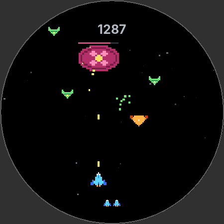
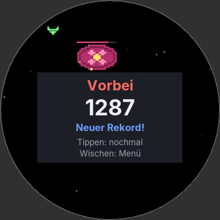

# Kronen-Shooter

Kleines Weltraum-Spiel für Wear-OS-Uhren, gebaut für die Google Pixel Watch 5. Die **Krone** steuert ein Raumschiff
nach links und rechts, geschossen wird ununterbrochen von selbst. Von oben kommen Gegner in zufälliger Zahl und
werden im Flug immer schneller: kleine fallen beim ersten Treffer, mittlere halten mehrere aus, große sehr viele. Jeder Gegner, der unten hinausfliegt oder
das Schiff rammt, kostet ein Leben (1 bis 5, einstellbar). Es gibt kein Gewinnen, nur einen möglichst hohen Punktestand.

| | |
|---|---|
| Modul | `wear/` (Uhr-App), `core/` (Spiellogik, reines Java) |
| Technik | Java, nur Android-Framework, keine Bibliotheken; minSdk 30 (Wear OS 3), targetSdk 35 |
| Größe | APK rund 45 KB |
| Daten | Rekorde und Einstellungen auf der Uhr, läuft ohne Handy |
| Version | 1.2 (versionCode 3) |

<p>
  
  
</p>

*Vorschaubilder aus `PreviewReport` (gerendert auf dem Rechner, nicht auf der Uhr).*

## Funktionen

- Steuerung nur mit der Krone, wie ein Drehregler: Drehen verschiebt das Schiff sofort, ohne Trägheit. Drei
  Empfindlichkeiten, Richtung umkehrbar.
- Dauerfeuer mit 7 Schuss/s.
- Drei Gegnerarten mit 1, 5 und 40 Trefferpunkten, Punkte **1 / 3 / 10** je Abschuss.
- Gegner kommen in Wellen mit zufälliger Anzahl, Mischung und Position und beschleunigen im Flug: oben langsam,
  auf Höhe des Schiffs fast eineinhalbmal so schnell. Alle Gegner liegen in der Reichweite des Schiffs.
- **Gegnermenge** im Menü: wenig, mittel, viel, sehr viel.
- **Leben** 1 bis 5 per Schieberegler (Standard 3). Rekord je Kombination aus Gegnermenge und Leben.
- Die Schwierigkeit steigt über 5 Minuten und danach langsam weiter, damit jede Partie endet.
- Nach einer Kollision ist das Schiff 1 s unverwundbar, damit eine Gruppe nicht alle Leben auf einmal nimmt.
- Rekord bleibt gespeichert, „Neuer Rekord!“ am Ende.
- Pause automatisch, sobald die App den Vordergrund verliert (Handgelenk runter, Benachrichtigung, Krone drücken).
  Weiter durch Tippen. Wischen nach rechts (Zurück) geht jederzeit ins Menü, auch mitten im Spiel.
- Auf Akku optimiert: Takt nur während des Spiels, 30 Bilder/s (umschaltbar auf 60), schwarzer Hintergrund,
  keine Objekte pro Bild, kein Dienst, kein Netz, keine Sensoren.
- Messseite für die Krone, um die Empfindlichkeit an der echten Uhr einzustellen.

## Schnellstart

**Auf die Uhr bringen:** An der Uhr Entwickleroptionen, ADB-Debugging und *Debugging über WLAN* einschalten, in
Android Studio *Pair Devices Using Wi-Fi*, dann Run-Konfiguration **wear** und die Uhr wählen, *Run ▶*. Schritt für
Schritt in [docs/uhr.md](docs/uhr.md#auf-die-uhr-bringen).

**Bauen:** Repository in Android Studio öffnen (*File → Open*), Gradle-Sync abwarten. Ohne Android Studio und ohne
Googles Maven-Repository: `tools/build-apk.sh`. Details in [docs/entwicklung.md](docs/entwicklung.md).

**Tests:** `./gradlew :core:test` oder `./tools/test.sh` (68 Tests, Balancing-Bericht, Vorschaubilder).

## Bedienung

| Wo | Was |
|---|---|
| Menü | Rekord für die eingestellte Gegnermenge und Lebenszahl, „Start“; darunter Gegner (wenig / mittel / viel / sehr viel), Schieberegler Leben (1–5), Krone (langsam / mittel / schnell), Richtung, Vibration, Bildrate, „Krone messen“. Antippen schaltet um, den Regler ziehen oder antippen. Krone scrollt. |
| Spiel | Krone drehen: Schiff nach links/rechts (Uhrzeigersinn = rechts). Wischen nach rechts: zurück ins Menü (die Partie endet, der Rekord bleibt). Tippen wirkt nicht. |
| Pause | Tippen: weiter. Wischen: zurück ins Menü. |
| Ende | Tippen (nach 0,8 s): neue Partie. Wischen: Menü. |

## Projektstruktur

```
core/                       reines Java ohne Android
  src/main/java/…/core/     Game (Regeln), Arena (Kreisgeometrie), Spawner, Difficulty, Tuning (alle Werte),
                            GameRenderer (Zeichenreihenfolge über Painter), Sprites, CrownInput, FrameClock
  src/test/java/…/core/     JUnit-Tests, BalanceReport (Bot-Spieler), PreviewReport (PNG)
wear/                       Uhr-App
  src/main/java/…/wear/     MainActivity (Menü), GameActivity, GameView (Takt), CanvasPainter,
                            CrownTestActivity, Store
  src/main/res/             Layouts, Farben, Texte, Symbol (aus dem Schiff-Sprite erzeugt)
tools/                      build-apk.sh (APK ohne Gradle), test.sh (Tests ohne Gradle)
keystore/                   Signaturschlüssel (nur private Nutzung)
docs/                       Dokumentation
```

## Dokumentation

- [docs/spiel.md](docs/spiel.md): Regeln, alle Werte, Schwierigkeit, Balancing
- [docs/uhr.md](docs/uhr.md): Bedienung, Energie, Installation auf der Uhr, Krone einstellen, Aufbau
- [docs/entwicklung.md](docs/entwicklung.md): Bauen, Tests, Vorschaubilder, Signatur
- [docs/plan.md](docs/plan.md): Entscheidungen aus der Planung und Abweichungen bei der Umsetzung
- [CHANGELOG.md](CHANGELOG.md)

## Stand

- **Noch nicht auf einer Uhr getestet.** Geprüft:
  - die Spiellogik mit 68 Unit-Tests;
  - das Balancing mit 2600 simulierten Partien;
  - die Uhr-App mit `javac -Xlint:all -Werror` gegen API 35 und gegen API 30 (minSdk);
  - die APK mit aapt2, dx und apksigner gebaut;
  - alle `findViewById` stimmen mit den Layouts überein.
- Die Empfindlichkeit der Krone ist geschätzt. Mit „Krone messen“ an der Uhr bestimmen, siehe
  [docs/uhr.md](docs/uhr.md#krone-einstellen).
- Ob das Display auf 30 Hz heruntergeht und wie viel Akku eine Partie kostet, muss an der Uhr gemessen werden
  ([docs/uhr.md](docs/uhr.md#energie)).
