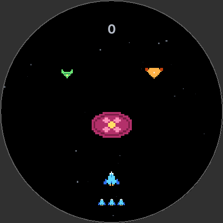

# Spielregeln und Werte

Alle Werte stehen in `core/…/Tuning.java` und `EnemyType.java`. Die Regeln setzt `Game` um, Prüfungen in
`RulesTest`, `CollisionTest`, `SpawnerTest`, `FlightTest` und `ArenaTest`.

## Spielfeld

Das Spielfeld ist 1000 × 1000 Einheiten (E) groß, y wächst nach unten. Auf runden Uhren ist nur der Kreis mit
Mittelpunkt (500, 500) und Radius 500 sichtbar, auf eckigen das ganze Quadrat (`Arena`). Die App skaliert das Feld
auf das Display, deshalb verhält sich das Spiel auf der 41- und der 45-mm-Uhr gleich.

Die Logik läuft in festen Schritten von 1/60 s (`FrameClock`), unabhängig von der Bildrate: bei 30 Bildern/s zwei
Schritte je Bild, bei 60 einer. Lücken über 0,1 s (Ruckler) werden gekappt.

## Schiff und Krone

| | |
|---|---|
| Lage | y = 800, 70 × 64 E |
| Bahn | x ∈ [171,1; 828,9] (657,7 E) |
| Steuerung | Krone in dp × Empfindlichkeit = Verschiebung in E, sofort, ohne Trägheit |
| Empfindlichkeit | langsam 1,2 / mittel 2,0 / schnell 3,4 E pro dp (Startwerte, an der Uhr zu bestimmen) |
| Richtung | Uhrzeigersinn = rechts, im Menü umkehrbar |

**Bahn:** Unterhalb von y = 800 wird der Kreis schmaler, deshalb begrenzen die unteren Ecken des Schiffs die Bahn.
Die Bahn ist die Sehne an der Unterkante (y = 832, halbe Breite √(500² − 332²) = 373,9 E) minus halbe Schiffsbreite
(35 E) und 10 E Rand. Ein erster Entwurf mit der Sehne auf Höhe der Schiffsmitte ließ die Ecken am Rand aus dem Kreis
ragen; das fiel in `ArenaTest` auf.

Mit „mittel“ braucht die ganze Bahn rund 330 dp Drehung.

## Dauerfeuer

7 Schuss/s, Geschoss 8 × 24 E mit 1400 E/s nach oben. Es sind höchstens 4 gleichzeitig unterwegs (Speicher für 8).

- **Treffer:** Geprüft wird die ganze Strecke, die das Geschoss in einem Schritt zurücklegt (23,3 E), damit es
  nicht durch einen flachen Gegner (39 E) hindurchspringt. Bei mehreren Gegnern trifft es den mit der tiefsten
  Unterkante. `CollisionTest` prüft das im Raster von 1,7 E.
- **Oben:** Ein Geschoss verschwindet, sobald es ganz oberhalb des sichtbaren Bereichs ist. Gegner, die noch
  nicht zu sehen sind, kann man also nicht treffen (bis auf höchstens 47 E im letzten Schritt).

## Gegner

| Art | Größe (E) | Trefferpunkte | Grundtempo oben (E/s) | Punkte | Treffer sichtbar als |
|---|---|---|---|---|---|
| klein | 50 × 39 | 1 | 130–180 | 1 | Explosion |
| mittel | 80 × 49 | 5 | 90–115 | 3 | weißer Blitz, Funken, Lebensbalken |
| groß | 180 × 115 | 40 | 33–41 | 10 | Funken, Lebensbalken |

Das Grundtempo ist zufällig im Bereich und wird mit dem Tempofaktor der Schwierigkeit multipliziert. Große Gegner
blitzen bewusst nicht: Bei 7 Treffern/s würden sie dauernd weiß flackern, und eine große weiße Fläche kostet auf
OLED unnötig Strom. Ab 1 Minute pendeln manche kleinen Gegner seitlich (± 40 E, 2,4 rad/s).

### Beschleunigung im Flug

Gegner werden schneller, je weiter unten sie sind: Tempo = Grundtempo × (1 + 0,6 · y / 1000), mit y auf [0, 1000]
begrenzt (`Game.flightFactor`, `Tuning.FLIGHT_ACCEL`). Oberhalb des Spielfelds fliegen sie mit dem Grundtempo.

| Höhe | oben (y = 0) | Mitte (500) | Schiff (800) | unten (1000) |
|---|---|---|---|---|
| Faktor | 1,00 | 1,30 | 1,48 | 1,60 |

Die Flugzeit ergibt sich aus dy/dt = v₀ · (1 + a·y/1000):
t = 1000 / (a·v₀) · ln((1 + a·y₁/1000) / (1 + a·y₀/1000)) (`Game.flightTime`, mit der Simulation verglichen in
`FlightTest`). Vom oberen Rand bis zum Schiff ist das 0,816 · 800 / v₀. Die Grundtempi wurden deshalb um rund 18 %
gesenkt (vorher 160–220, 110–140, 40–50 E/s): Die Zeit bis zum Schiff bleibt im Mittel gleich (höchstens 3 %
Abweichung, `FlightTest`), aber die Gegner kommen langsam herein und werden zum Schiff hin schnell.

Unabhängig davon steigt der Tempofaktor mit der Spielzeit (siehe [Schwierigkeit](#schwierigkeit)): Gegner werden
also im Flug schneller und im Lauf der Partie insgesamt schneller.

## Wellen und Fairness

Der `Spawner` erzeugt Wellen. Wie viele, legt die **Gegnermenge** im Menü fest (`Tuning.SPAWN_LEVELS`):

| Stufe | Faktor | Wirkung |
|---|---|---|
| wenig | 0,6 | Wellen im 1,67-fachen Abstand, Obergrenze der Trefferpunkte × 0,6 |
| mittel | 1,0 | Standard, wie in den Tabellen dieses Dokuments |
| viel | 1,5 | Wellen im 0,67-fachen Abstand, Obergrenze × 1,5 |
| sehr viel | 2,2 | Wellen im 0,45-fachen Abstand, Obergrenze × 2,2 |

Der Faktor wirkt auf den Abstand der Wellen und auf die Obergrenze der Trefferpunkte; ohne die zweite würde die
Grenze eine höhere Menge wieder abschneiden. Größe der Wellen, Mischung und Tempo bleiben gleich.

Zufällig sind:
- der Abstand der Wellen (± 25 % um den Mittelwert);
- die Anzahl (1 bis zur Höchstzahl);
- die Art jedes Gegners nach Gewichten;
- die Position;
- das Tempo.

Gegner einer Welle kommen versetzt, je weiterer Gegner bis zu 110 E weiter oben. Regeln, die das fair halten
(`SpawnerTest`, über 10.000 Gegner):

- **Erreichbar:** Jeder Gegner liegt mit seiner Mitte in der Bahn des Schiffs, große zusätzlich so, dass sie auf
  Höhe des Schiffs ganz sichtbar sind (190–810). Pendelnde liegen so, dass sie auch beim Pendeln in der Bahn bleiben.
  Ohne diese Regel könnte ein Gegner am Rand auftauchen, den man nicht treffen kann, und trotzdem ein Leben kosten.
- **Von oben:** Neue Gegner beginnen ganz oberhalb des sichtbaren Bereichs.
- **Keine Überlappung** mit vorhandenen Gegnern beim Erscheinen (12 E Abstand, sonst bis zu 12 neue Versuche).
- **Obergrenze der Trefferpunkte** aller Gegner im Spiel (mal Gegnermenge), gegen zufällige Spitzen, die nicht zu
  schaffen sind.
- **Große Gegner** frühestens nach 1 Minute, höchstens einer gleichzeitig, ab 3 Minuten zwei.
- Die erste Welle kommt nach 1,5 s.

## Schwierigkeit

`Difficulty` hängt nur von der Spielzeit t ab (Pausen zählen nicht). Die Tabelle gilt für die Gegnermenge
„mittel“; Wellenabstand und Grenze ändern sich mit der Stufe wie oben. Bis 5 Minuten steigen alle Werte linear vom
Start- auf den Endwert. Danach steigen Tempo (+0,1 je Minute) und Obergrenze der Trefferpunkte (+15 je Minute)
ohne Ende weiter: Es gibt kein Gewinnen, jede Partie endet irgendwann.

| Zeit | Wellenabstand | Gegner je Welle | Tempo | mittel | groß (max. gleichzeitig) | Grenze TP | pendelnd |
|---|---|---|---|---|---|---|---|
| 0 s | 2,40 s | 1–2 | ×1,00 | 20 % | 0 % (0) | 45 | 0 % |
| 1 min | 2,12 s | 1–3 | ×1,12 | 22 % | 1,2 % (1) | 54 | 0 % |
| 2 min | 1,84 s | 1–3 | ×1,24 | 25 % | 2,4 % (1) | 63 | 13 % |
| 3 min | 1,56 s | 1–4 | ×1,36 | 27 % | 3,6 % (2) | 72 | 25 % |
| 5 min | 1,00 s | 1–5 | ×1,60 | 32 % | 6,0 % (2) | 90 | 50 % |
| 7 min | 1,00 s | 1–5 | ×1,80 | 32 % | 6,0 % (2) | 120 | 50 % |
| 10 min | 1,00 s | 1–5 | ×2,10 | 32 % | 6,0 % (2) | 165 | 50 % |

## Leben

1 bis 5 Leben zu Beginn, eingestellt im Menü per Schieberegler (Standard 3, `Tuning.LIVES_MIN`/`LIVES_MAX`). Eines
geht verloren, wenn ein Gegner …

- **unten hinausfliegt:** sobald er ganz außerhalb des sichtbaren Bereichs ist, also seine Oberkante überall in
  seiner Breite unter dem Kreisrand liegt (`Arena.goneBelow`). Am Rand der Bahn ist das bei einer Oberkante von
  y ≈ 900 der Fall, in der Mitte bei y = 1000; ein Gegner, den man nicht mehr sieht, zählt sofort;
- **das Schiff berührt:** Trefferflächen 80 % (Schiff) bzw. 85 % (Gegner) der Sprites, das fühlt sich fairer an.
  Der Gegner explodiert ohne Punkte, damit er nicht zusätzlich unten hinausfliegt.

Nach einer Kollision ist das Schiff 1 s unverwundbar (es blinkt). Gegner, die es in dieser Zeit berühren,
explodieren ohne Lebensverlust und ohne Punkte. Hinausfliegende Gegner kosten immer ein Leben, auch in dieser
Zeit. Kein Gegner kostet mehr als ein Leben. Bei 0 Leben ist die Partie vorbei.

## Punkte und Rekord

Punkte nur für Abschüsse durch Geschosse: klein 1, mittel 3, groß 10. Es gibt einen **Rekord je Kombination aus
Gegnermenge und Leben** (4 × 5 = 20 Rekorde): Partien mit mehr Gegnern oder weniger Leben sind kürzer und punkten
anders, ein gemeinsamer Rekord wäre nicht vergleichbar. Ältere Rekorde werden mit 3 Leben übernommen: der aus 1.0
(immer „mittel“) als „mittel · 3 Leben“, die aus 1.1 je Gegnermenge als „… · 3 Leben“.

Gespeichert wird am Ende und zusätzlich, wenn die App mit überbotenem Rekord in den Hintergrund geht oder per
Wischen geschlossen wird. „Neuer Rekord!“ erscheint, wenn die Punkte den Rekord beim Start der Partie übertreffen.

## Anzeige

| Element | Lage (E) | Grund |
|---|---|---|
| Punkte | oben Mitte, Grundlinie y = 150, Größe 56 | dort ist der Kreis noch rund 650 E breit; der Blick ist ohnehin oben, wo die Gegner kommen. Gedimmt und unter den Gegnern gezeichnet, Ziffern gleich breit |
| Leben | bis zu 5 kleine Schiffe bei y = 905, mittig, 44 E Abstand | unter dem Schiff, im Kreis noch ±270 E Platz; 5 Leben brauchen ±106 E (`RendererTest`) |
| Pause / Ende | Feld 170–830 × 330–740 | alle Ecken im Kreis (`RendererTest`) |

## Balancing

Gemessen mit `BalanceReport`: je 200 Partien (Seeds 1000–1199) für vier Spieler bei Gegnermenge „mittel“. Der Bot
fährt zum Gegner mit der frühesten Frist, für den noch nicht genug Geschosse unterwegs sind. Frist heißt: Zeit bis
zur Berührung (mit Beschleunigung im Flug) minus nötige Schüsse und Flugzeit. Sein Tempo ist begrenzt wie ein
Mensch an der Krone.

| Spieler | Dauer Median (min – max) | Punkte Median |
|---|---|---|
| Bot, 1200 E/s (ganze Bahn in 0,55 s) | 222 s (167 – 294) | 395 |
| Bot, 600 E/s | 192 s (107 – 249) | 312 |
| „wie Mensch“: 600 E/s, neue Zielwahl nur alle 0,3 s | 186 s (103 – 240) | 283 |
| ohne Krone (Schiff bleibt in der Mitte) | 9 s (7 – 16) | 0 |

Je Lebenszahl („wie Mensch“, Gegnermenge mittel, je 200 Partien):

| Leben | Dauer Median (min – max) | Punkte Median |
|---|---|---|
| 1 | 166 s (82 – 231) | 238 |
| 2 | 177 s (102 – 238) | 265 |
| 3 | 186 s (103 – 240) | 283 |
| 4 | 190 s (103 – 240) | 298 |
| 5 | 199 s (126 – 242) | 315 |

Die Zahl der Leben verlängert eine Partie nur wenig (1 → 5 Leben: +20 %). Ein Bot macht am Anfang praktisch keine
Fehler, und am Ende steht die Schwierigkeitswand: Sobald mehr Trefferpunkte kommen, als das Schiff mit 7 Schuss/s
abbauen kann, sind auch 5 Leben in wenigen Sekunden weg. Bei einem Menschen, der früh Fehler macht, wirken die
Leben stärker. Soll die Lebenszahl mehr ausmachen, müsste die Wand flacher werden (z. B. langsamerer Anstieg nach
5 min).

Je Gegnermenge („wie Mensch“, 3 Leben, je 200 Partien):

| Stufe | Dauer Median (min – max) | Punkte Median |
|---|---|---|
| wenig | 266 s (196 – 314) | 321 |
| mittel | 186 s (103 – 240) | 283 |
| viel | 139 s (79 – 198) | 272 |
| sehr viel | 93 s (66 – 148) | 221 |

Ein echter Mensch entscheidet schlechter als jeder Bot. Erwartet sind deshalb eher 2–3 Minuten je Partie, passend
für die Uhr. Der Bericht prüft:
- jede Partie endet;
- kein Bot ist vor 90 s am Ende;
- der Median liegt im Ziel (Bot 2–6 min, „wie Mensch“ 2–4 min);
- ein großer Gegner ist auch am Rand der Bahn und beim höchsten Tempo der Steigerung (Grundtempo 66 E/s, mit
  Beschleunigung) allein immer zu schaffen: 9,1 s Zeit, 6,2 s nötig;
- je Gegnermenge: mehr Gegner ergeben kürzere Partien, jede Partie endet, keine ist vor 30 s vorbei;
- je Lebenszahl: mehr Leben ergeben längere Partien, jede Partie endet.

**Herleitung.** Begrenzend ist die Feuerrate: Das Schiff schafft höchstens 7 Treffer pro Sekunde. Die Gegner
verlangen im Mittel (Gegner je Welle / Wellenabstand) × (mittlere Trefferpunkte je Gegner). Mit den ersten
Startwerten (Steigerung über 3 min, Wellenabstand bis 0,7 s, bis zu 6 Gegner je Welle, 6 Schuss/s) lag das schon
nach 90 s bei rund 6,7 Treffern/s, und der Bot hielt im Median nur 110 s durch. Verglichen wurden dann sechs
Varianten:

| Variante | Änderung gegenüber dem Start | Bot | „wie Mensch“ |
|---|---|---|---|
| Start | Steigerung 180 s, Abstand 2,0 → 0,7 s, bis 6 je Welle, 6 Schuss/s | 110 s | – |
| A | Steigerung 240 s, Abstand 2,2 → 0,9 s, bis 5 je Welle | 160 s | – |
| B | wie A, Steigerung 300 s | 189 s | 163 s |
| D | wie A, Steigerung 360 s | 218 s | 182 s (min 79) |
| E | wie B, 7 Schuss/s | 210 s | 176 s |
| **F (gewählt)** | wie E, Abstand 2,4 → 1,0 s | 220 s | 187 s (min 116) |

F hat den fairsten Anfang (das späteste frühe Ende). Die Werte in der Tabelle oben sind der Stand nach den letzten
Änderungen (Funken mit eigenem Zufallsgenerator, in 1.1 Beschleunigung im Flug), deshalb leicht anders als in dieser
Zeile. Die Beschleunigung mit den gesenkten Grundtempi hat das Ergebnis kaum verschoben (Bot 220 → 222 s,
„wie Mensch“ 182 → 186 s).

Ein erster Bot wählte das Ziel nach Spielraum einschließlich Weg. Er pendelte zwischen zwei ähnlich dringenden
Gegnern und blieb stehen (Median 46 s); der Vergleich nach Frist ohne Weg und das Festhalten am Ziel beheben das.

## Grafik

Eigene Pixel-Sprites (`Sprites`), keine Vorlage aus bestehenden Spielen:

| Sprite | Raster | Form |
|---|---|---|
| Schiff | 11 × 10 | Pfeil mit Cockpit, Flügeln und zwei Triebwerken |
| klein | 9 × 7 | Drohne, Spitze nach unten |
| mittel | 13 × 8 | Delta-Jäger mit zwei Triebwerken |
| groß | 22 × 14 | sechseckiger Rumpf mit leuchtendem Kern |

Hintergrund schwarz mit 32 gedimmten Sternen, die langsam nach unten ziehen. Funken und Sterne haben einen eigenen
Zufallsgenerator, damit Optik den Ablauf einer Partie nicht verändert (gleicher Seed = gleiche Gegner).

