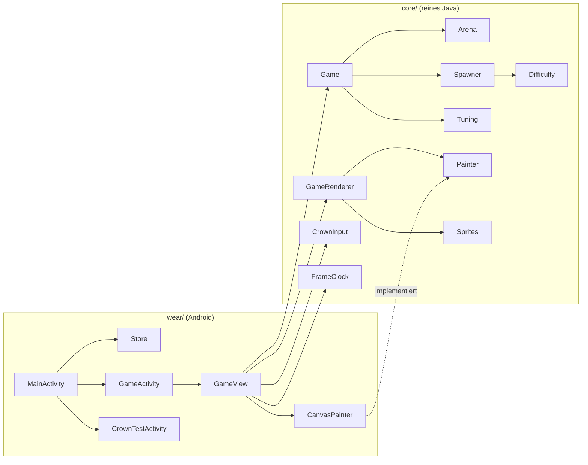

# Uhr-App (Wear OS)

Eigenständige App für Wear-OS-Uhren, gebaut für die Google Pixel Watch 5 (Wear OS 7). Sie läuft **ohne Handy**,
braucht kein Netz und speichert nur Rekord und Einstellungen auf der Uhr.

| | |
|---|---|
| Modul | `wear/` im Android-Studio-Projekt, Spiellogik in `core/` |
| Geräte | Wear OS 3 oder neuer (minSdk 30), runde und eckige Bildschirme |
| Technik | Java, nur Android-Framework (keine AndroidX-Bibliotheken) |
| Paketname | `de.kronenshooter`, Code in `de.kronenshooter.wear` |
| Berechtigungen | nur `VIBRATE` (normale Berechtigung, ohne Nachfrage) |
| Version | 1.0 (versionCode 1) |

## Bedienung

Jede Seite ist eine eigene Activity. **Wischen nach rechts** geht eine Seite zurück (Standard auf Wear OS).

| Seite | Inhalt | Bedienung |
|---|---|---|
| Menü (Start) | Name, Rekord, „Start“, Krone (langsam / mittel / schnell), Richtung (normal / umgekehrt), Vibration (an / aus), Bildrate (30 / 60), „Krone messen“, Kurzhilfe | Antippen startet bzw. schaltet um, wird sofort gespeichert. Krone scrollt. Wirkt ab dem nächsten Spiel |
| Spiel | Punkte oben, Schiff unten, darunter die Leben | **Krone:** Schiff links/rechts. Tippen und Wischen wirken nicht (die Hand an der Krone streift leicht den Rand) |
| Pause | Feld „Pause“ über dem eingefrorenen Spiel | Tippen: weiter. Wischen: Menü |
| Ende | „Vorbei“, Punkte, „Neuer Rekord!“ oder „Rekord …“ | Tippen (frühestens nach 0,8 s): neue Partie. Wischen: Menü |
| Krone messen | Summe der Drehung in dp, Anzahl Ereignisse, letzte Drehung, Umdrehungen für die ganze Bahn | Krone drehen; Antippen setzt zurück |

- **Pause automatisch:** Sobald die App den Vordergrund verliert (`onPause`), steht das Spiel. Auslöser sind
  Handgelenk runter, eine Benachrichtigung, die Schnelleinstellungen, ein Druck auf die Krone oder die Seitentaste.
  Nach der Rückkehr steht „Pause“ da; weiter geht es erst nach Tippen, damit nichts passiert, während man das
  Handgelenk noch hebt.
- **Bildschirm:** bleibt wach, solange gespielt wird (`FLAG_KEEP_SCREEN_ON`). Stillstehen ist im Spiel normal, ohne
  das ginge der Bildschirm mitten im Spiel aus. In Pause, am Ende und im Menü gilt das normale Zeitlimit der Uhr.
- **Vibration:** kurz und kräftig bei jedem verlorenen Leben, doppelt am Ende.
- Eine laufende Partie wird nicht gespeichert. Beendet das System die App im Hintergrund, ist sie verloren, der
  Rekord nicht.

## Energie

Außerhalb einer laufenden Partie verbraucht die App nichts: kein Dienst, kein Alarm, kein Netz, keine Sensoren,
kein Wakelock. Während des Spiels kosten vor allem die Bildwechsel Energie.

| Maßnahme | Wirkung |
|---|---|
| Takt nur beim Spielen, zwischen `onResume` und `onPause` | in Pause, am Ende, hinter Schnelleinstellungen oder Benachrichtigungen kein einziges Bild |
| **30 Bilder/s** (im Menü auf 60 umschaltbar), Logik fest 60 Hz | halbe Zeichenarbeit bei gleichem Spielverhalten. Wunsch an das Display über `preferredRefreshRate` und ab Android 15 `View.setRequestedFrameRate` |
| Vsyncs zwischen zwei Bildern werden ausgelassen | das Spiel liefert nie mehr Bilder als eingestellt, auch wenn das Display mit 60 Hz läuft |
| Keine Objekte pro Bild | feste Speicher für Gegner, Geschosse, Funken; Paints und Sprite-Bitmaps einmal angelegt; Punktetext nur bei Änderung neu |
| Sprites als kleine Bitmaps, ohne Filter skaliert | ein `drawBitmap` je Objekt |
| Schwarzer Hintergrund nur vom Fenster | OLED: schwarze Pixel bleiben aus, keine zusätzliche Vollbild-Füllung |
| Helle Farben nur auf kleinen Flächen | große Gegner blitzen bei Treffern nicht weiß (Funken statt Blitz) |
| Vibration sparsam, abschaltbar | nur bei Lebensverlust und am Ende |
| Kein Always-on-Modus | abgedunkelter Bildschirm = Pause |

**Nachmessen an der Uhr** (wichtig: noch nicht gemessen):

```sh
# Bilder pro Minute (Erwartung: rund 1800 bei 30/s, 3600 bei 60/s)
adb shell dumpsys gfxinfo de.kronenshooter reset
# eine Minute spielen
adb shell dumpsys gfxinfo de.kronenshooter | grep -E "Total frames rendered|Janky frames"

# Bildwiederholrate des Displays während des Spiels (geht es auf 30 Hz?)
adb shell dumpsys SurfaceFlinger | grep -iE "refresh|fps" | head

# Akku: Stand vor und nach 10 Minuten Spiel, je einmal mit 30 und 60 Bildern/s
adb shell dumpsys battery | grep level
```

Danach legen wir fest, ob 30 Bilder/s bleiben. Zeigen die Messungen kaum Unterschied im Akku, aber spürbar
flüssigeres Spiel mit 60, wird 60 der Standard (`Store.fps()`).

## Krone einstellen

Wie viele dp eine Umdrehung der Krone ergibt, hängt von der Uhr ab und ist nicht dokumentiert. Die Werte in
`CrownInput.GAIN` (1,2 / 2,0 / 3,4 E pro dp) sind geschätzt: Bei „mittel“ soll etwa eine halbe Umdrehung die ganze
Bahn abfahren. So bestimmst du sie:

1. Menü → **Krone messen**.
2. Krone **genau eine Umdrehung** im Uhrzeigersinn drehen, langsam und gleichmäßig.
3. Ablesen: die Summe in dp und „Ganze Bahn bei ‚mittel‘: … Umdrehungen“. Zum Wiederholen antippen.
4. Den dp-Wert durchgeben. Daraus werden die drei Stufen so gesetzt, dass die ganze Bahn bei
   langsam / mittel / schnell etwa 0,8 / 0,5 / 0,3 Umdrehungen braucht.

Fühlt sich die Richtung falsch an: Menü → Richtung → umgekehrt.

## Auf die Uhr bringen

Für eine private App ohne Play Store geht das über **Debugging per WLAN**, wie bei substanz-tracker. Benötigt wird
ein Rechner mit Android Studio (oder nur den Android-SDK-Platform-Tools mit `adb`) im selben WLAN wie die Uhr.

### 1. Uhr vorbereiten (einmalig)

1. Entwickleroptionen freischalten: *Einstellungen → System → Info → Versionen → Build-Nummer* siebenmal antippen.
   Die Bezeichnungen können je nach Wear-OS-Version leicht abweichen.
2. *Einstellungen → Entwickleroptionen*: **ADB-Debugging** einschalten, dann **Debugging über WLAN**
   (*Wireless debugging*) einschalten und *Immer in diesem Netzwerk zulassen* wählen.
3. Uhr und Rechner ins selbe WLAN. Gäste- und Firmennetze trennen Geräte oft voneinander; dann den Hotspot des
   Handys nutzen.

Ist die Uhr schon für substanz-tracker eingerichtet und gekoppelt, entfallen die Schritte 1 und 2.

### 2. Koppeln (einmalig)

- **Android Studio:** Geräteauswahl oben → *Pair Devices Using Wi-Fi* → *Pair using pairing code*. Auf der Uhr
  *Debugging über WLAN → Neues Gerät koppeln* öffnen und den angezeigten Code eingeben.
- **Terminal:** Auf der Uhr *Neues Gerät koppeln* öffnen, dann

  ```sh
  adb pair 192.168.1.23:41234        # IP und Kopplungs-Port von der Uhr, danach den Code eingeben
  adb connect 192.168.1.23:37000     # IP und Port vom Hauptbildschirm "Debugging über WLAN" (anderer Port!)
  adb devices                        # die Uhr muss erscheinen
  ```

`adb connect` ist nach jedem Neustart der Uhr oder WLAN-Wechsel erneut nötig, das Koppeln nicht.

### 3. Installieren

- **Android Studio (empfohlen):** Projekt öffnen und den Gradle-Sync abwarten. Oben die Run-Konfiguration
  **wear** und die Uhr als Gerät wählen, dann *Run ▶*. Android Studio baut, installiert und startet die App.
- **Fertige APK mit adb** (aus Android Studio unter `wear/build/outputs/apk/debug/wear-debug.apk` oder aus
  `tools/build-apk.sh` als `build/KronenShooter.apk`):

  ```sh
  adb -s 192.168.1.23:37000 install -r build/KronenShooter.apk
  ```

  `-r` ersetzt eine vorhandene Version und behält Rekord und Einstellungen. Beide Wege signieren mit demselben
  Schlüssel und lassen sich übereinander installieren.

Die App erscheint danach in der App-Liste der Uhr als „Kronen-Shooter“.

### 4. Danach

*Debugging über WLAN* wieder ausschalten, es kostet Akku. ADB-Debugging kann an bleiben. Für ein Update genügt
es, *Debugging über WLAN* wieder einzuschalten, `adb connect` und erneut installieren.

### Fehler beim Installieren

| Meldung | Ursache / Abhilfe |
|---|---|
| `failed to connect` / Uhr fehlt in `adb devices` | anderes WLAN oder Netz mit Geräte-Trennung; Port vom Hauptbildschirm verwenden, nicht den Kopplungs-Port; *Debugging über WLAN* aus- und einschalten; `adb kill-server` |
| `INSTALL_FAILED_UPDATE_INCOMPATIBLE` | auf der Uhr ist eine App mit diesem Paketnamen, aber anderer Signatur; deinstallieren (löscht den Rekord) |
| `INSTALL_FAILED_VERSION_DOWNGRADE` | auf der Uhr ist eine neuere Version; `adb install -r -d …` oder vorher deinstallieren |
| `INSTALL_FAILED_OLDER_SDK` | Uhr mit Wear OS 2 oder älter (minSdk 30 = Wear OS 3) |
| `INSTALL_PARSE_FAILED_…` | beschädigte oder falsch gebaute APK; mit Android Studio neu bauen |

### Ohne Uhr ausprobieren

Android Studio → *Device Manager* → *+* → Kategorie *Wear OS* → z. B. *Wear OS Large Round*, Systemabbild
herunterladen. Dann **wear** und den Emulator wählen, *Run ▶*. Die Krone wird im Emulator über
*Extended Controls → Rotary input* simuliert. Bildrate und Akku lassen sich im Emulator nicht sinnvoll messen.

## Aufbau



`core` ist ein reines Java-Modul (Gradle-Plugin `java-library`). Seine Tests laufen ohne Gerät auf dem Rechner,
der Painter-Umweg erlaubt Zeichentests (`RecordingPainter`) und Vorschaubilder (`AwtPainter`).

| Klasse (core) | Aufgabe |
|---|---|
| `Game` | eine Partie: fester Schritt, Bewegung, Dauerfeuer, Treffer, Kollisionen, Leben, Punkte, Zustand (Spiel / Pause / Ende), Zähler für Vibration und Statistik |
| `Arena` | Kreisgeometrie: Breite auf Höhe y, Ränder, Bahn des Schiffs, Bereich für neue Gegner, „ganz unten hinaus“ |
| `Spawner`, `Difficulty` | Wellen mit Zufall und Fairness-Regeln; Schwierigkeit als Funktion der Spielzeit |
| `Enemies`, `Bullets`, `Particles`, `Stars` | feste Speicher als Arrays |
| `EnemyType`, `Tuning` | alle Spielwerte |
| `CrownInput` | Krone (dp) in Verschiebung (E): Empfindlichkeit, Richtung |
| `FrameClock` | Bildzeitpunkte in feste Logikschritte, Lücken gekappt |
| `GameRenderer`, `Painter`, `Sprites`, `Palette`, `Texts` | Zeichenreihenfolge, Zeichen-Schnittstelle, Pixel-Sprites, Farben, Texte im Spielfeld |

| Klasse (wear) | Aufgabe |
|---|---|
| `WearActivity` | Grundlage: Innenabstände für runde Bildschirme, Krone (`dispatchGenericMotionEvent`, Quelle `ROTARY_ENCODER`) |
| `MainActivity` | Menü und Einstellungen |
| `GameActivity` | Lebenszyklus, Krone an das Spiel, Bildschirm wach halten, Bildrate anfordern, Vibration, Rekord |
| `GameView` | Takt über den Choreographer (nur beim Spielen, Vsyncs zwischen den Bildern ausgelassen), Tippen in Pause und am Ende, sperrt Wischen zum Schließen während des Spiels |
| `CanvasPainter` | `Painter` auf `Canvas`, Sprites als Bitmaps ohne Filter |
| `CrownTestActivity` | Messseite für die Krone |
| `Store` | Rekord und Einstellungen (SharedPreferences `kronen_shooter`) |

**Ein Bild im Spiel:** Der Choreographer meldet den Vsync. Ist seit dem letzten Bild weniger als 1/Bildrate
(minus 4 ms Toleranz) vergangen, wartet `GameView` auf den nächsten Vsync. Sonst bestimmt `FrameClock` die Zahl der
Schritte (meist 2 bei 30 Bildern/s), `Game.step()` läuft so oft, dann zeichnet `GameRenderer` über
`CanvasPainter`. Endet die Partie, steht der Takt sofort.

**Wischen zum Schließen:** Wear OS schließt eine Activity, wenn man nach rechts wischt, außer die Ansicht unter dem
Finger meldet, dass sie waagerecht scrollen kann. `GameView` meldet das, solange gespielt wird (derselbe Weg wie
beim Fadenkreuz in substanz-tracker).

## Stand und Grenzen

- **Version 1.0 ist noch nicht auf einer Uhr getestet.** Geprüft wurde:
  - 58 Unit-Tests der Spiellogik inklusive Balancing-Bericht;
  - die Uhr-App kompiliert mit `javac -Xlint:all -Werror` gegen API 35;
  - gegen API 30 ist der einzige neuere Aufruf `View.setRequestedFrameRate`, hinter einer Versionsabfrage;
  - die APK ist mit aapt2, dx, zipalign und apksigner gebaut;
  - alle `findViewById` und Texte stimmen mit den Ressourcen überein;
  - Layout und Sprites wurden als Vorschaubilder geprüft.
- Nicht geprüft: Gradle-Sync (Googles Maven-Repository war nicht erreichbar; die Gradle-Dateien entsprechen
  substanz-tracker ohne Tiles), Verhalten auf dem Gerät.
- Zu messen bzw. einzustellen an der Uhr: Empfindlichkeit der Krone ([oben](#krone-einstellen)), Bildrate und Akku
  ([Energie](#energie)), ob Wischen während des Spiels wirklich nichts schließt.
- Keine Kachel und keine Komplikation (Rekord auf dem Zifferblatt). Beides bräuchte AndroidX-Bibliotheken.
- Kein Ton (nicht gefordert, und auf der Uhr meist unpassend).
